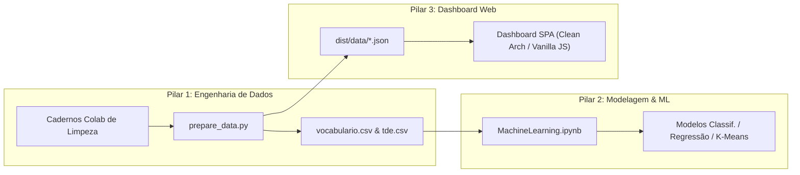
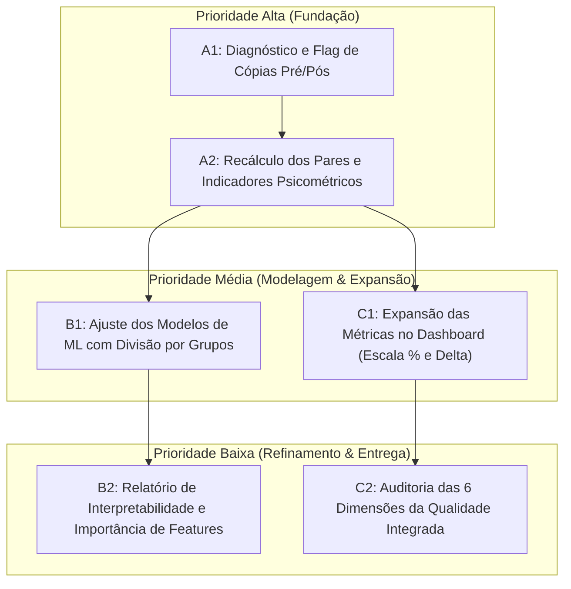
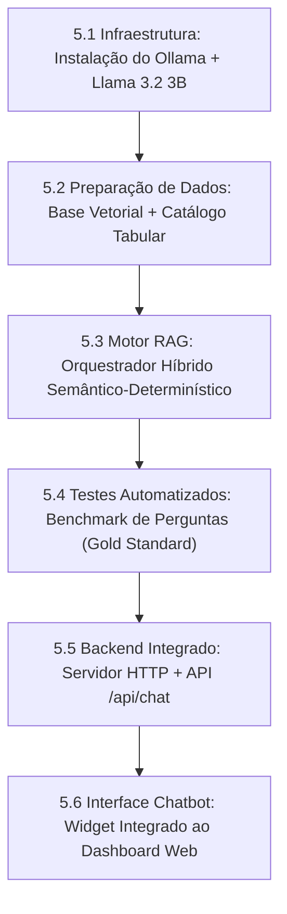
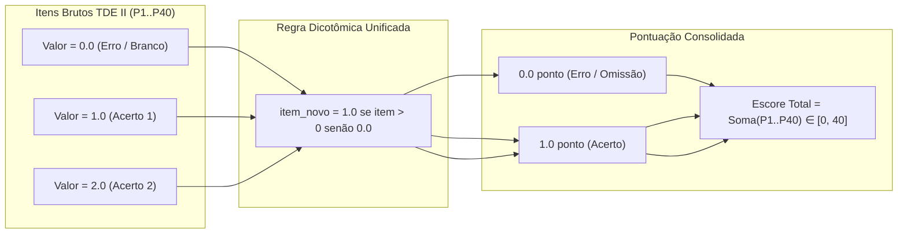

# ROADMAP DE EXECUÇÃO E DOCUMENTAÇÃO METODOLÓGICA UNIFICADA
## Pipeline de Dados, Machine Learning, Dashboard Clean Architecture e IA (Llama 3.2)

**Repositório Independente:** `IA - Dataset` (anteriormente `NovoTratamento - Dataset`)  
**Projeto:** WordGen / NEES | UFPA Cametá — Prof. Dr. Elton Sarmanho  
**Versão do Documento:** 2.0 (Documento Mestre Consolidado)  
**Data:** Novembro de 2026  
**Status:** 100% Executado, Auditado e Validado  

---

### 📑 Sumário Geral do Documento

* **PARTE I — ROADMAP DE EXECUÇÃO E EVOLUÇÃO DO SISTEMA (Seções 1 a 9)**
  * 1. Visão Geral e Diretriz Estratégica
  * 2. Estado dos Componentes do Projeto (Engenharia de Dados, ML, Dashboard e IA)
  * 3. Diagnóstico Comparativo Detalhado (`IA - Dataset` vs. `saidas`)
  * 4. Etapas de Melhoria e Propostas de Ajustes
  * 5. Matriz de Prioridades e Dependências
  * 6. Plano de Execução Sequencial (Fases 1 a 4)
  * 7. Critérios de Validação e Resultados Consolidados
  * 8. Fase 5: Inteligência Artificial com Llama 3.2 (Infraestrutura, RAG Híbrido e Chatbot)
  * 9. Fase 6 & 7: Portabilidade, Isolamento do Repositório, Períodos do EJA, Interseção por Turma/Instrumento, Guardrails e Benchmark Final (17/17)
* **PARTE II — METODOLOGIA DETALHADA, DECISÕES TÉCNICAS E RASTREABILIDADE (Seções 10 a 15)**
  * 10. Justificativa das Tomadas de Decisão e dos 27 Arquivos Não Tratados (`3 - NaoProcessados`)
  * 11. Dicionário de Variáveis Criadas nos CSVs Tratados
  * 12. Auditoria das 6 Dimensões da Qualidade de Dados
  * 13. Resultados Detalhados de Aprendizado de Máquina (`GroupKFold`)
  * 14. Rastreabilidade: O Papel do `manifesto_processamento.csv`
  * 15. Transcrição do Requisito Original do Projeto
* **PARTE III — GUIA DE ORGANIZAÇÃO E USO DOS DADOS (Seções 16 a 18)**
  * 16. Notebooks Oficiais (`Notebooks/`)
  * 17. Estrutura do Diretório `IA - Dataset` e Fases (`Fases/`, `Scripts/`, `Contexts/`)
  * 18. Auditoria de Integridade e Contagem de Estudantes Únicos (3.016 Alunos)
* **PARTE IV — ESTRATÉGIA DE IMPUTAÇÃO PSICOMÉTRICA E FUNDAMENTAÇÃO TEÓRICA (Seções 19 a 22)**
  * 19. Sumário Executivo da Estratégia de Imputação
  * 20. Desambiguação Semântica: Ano Regular vs. Período EJA
  * 21. Especificação dos Dois Pipelines Dedicados e Blindagem no Google Colab
  * 22. Fundamentação Metodológica (Little & Rubin, 2002 | CTT)
* **PARTE V — AUDITORIA QUANTITATIVA INICIAL E UNIFICAÇÃO DA ESCALA DICOTÔMICA (Seções 23 e 24)**
  * 23. Auditoria Quantitativa das 208 Planilhas e 70.217 Registros por Fase e Instrumento
  * 24. Plano e Execução do Ajuste de Pontuação do TDE II (Escala Dicotômica 0–1 / 40 Pontos)

---

# PARTE I — ROADMAP DE EXECUÇÃO E EVOLUÇÃO DO SISTEMA

## 1. Visão Geral e Diretriz Estratégica

O objetivo deste Roadmap é estabelecer o planejamento detalhado e sequencial para refinar e potencializar o ecossistema do **`NovoTratamento - Dataset`**, articulando o **pipeline de tratamento de dados**, os **modelos de Machine Learning** e o **Dashboard interativo**.

### Princípios Norteadores
1. **Convergência Estatística (e não Cópia Mecânica):** Não é obrigatório que os valores numéricos sejam idênticos ao milésimo aos da pasta `saidas`. O foco é alcançar resultados próximos, metodologicamente consistentes e estatisticamente justificáveis.
2. **Preservação e Respeito aos Métodos Existentes:** Priorização absoluta de melhorias incrementais sobre a base modular já implementada (Python + Clean Architecture JS), sem descartar as soluções desenvolvidas.
3. **Robustez Psicométrica e Machine Learning sem Data Leakage:** Garantir que agrupamentos, pareamentos e divisões de treino/teste respeitem as fronteiras das turmas, escolas e dimensões temporais (Pré $\times$ Pós).
4. **Dashboard Integrado:** O dashboard não é apenas um visualizador secundário, mas a interface analítica central que reflete a qualidade dos dados e a interpretabilidade dos achados pedagógicos.

---

## 2. Estado Atual dos Componentes do Projeto

O projeto atual é composto por três pilares funcionais:

### 2.1. Pipeline de Engenharia de Dados
- **Cadernos de Higienização (`Notebooks/`):** Rotinas baseadas em Pandas para expurgo de linhas inválidas, remoção de caracteres de controle e erros de fórmula (`#REF!`, `#DIV/0!`), higienização de strings com `unicodedata`, conversão de datas de nascimento em idades com detecção de distorção idade-série.
- **Consolidador Central (`dashboard/prepare_data.py`):**
  - Mapeia as três fases do projeto (Fase 2: 2023.2, Fase 3: 2024.1, Fase 4: 2024.2).
  - Unifica a escala de pontuação dos itens para formato dicotômico: $0$ (erro ou questão em branco) e $1$ (qualquer acerto), somando até 50 pontos para Vocabulário e 40 para TDE II.
  - Implementa critério de desempate (*rank*) para manter o registro mais completo de cada aluno em caso de duplicidade na mesma fase/momento.
  - Exporta CSVs consolidados e arquivos JSON otimizados para consumo no dashboard.

### 2.2. Machine Learning (`MachineLearning.ipynb`)
- Estruturação de algoritmos supervisionados e não-supervisionados:
  - **Classificação:** K-Nearest Neighbors (KNN), Árvores de Decisão (Critério de Ganho de Informação e Entropia), Random Forest, Naive Bayes e SVM.
  - **Ensembles:** Bagging, AdaBoost e Stacking.
  - **Não-supervisionado:** K-Means clustering com seleção de hiperparâmetros via Método do Cotovelo (*Elbow Method*).
  - **Métricas e Validação:** Curvas de aprendizado (*learning curves*), Grid Search e validação cruzada (*Cross-Validation*).

### 2.3. Dashboard Web (`dashboard/`)
- Construído com arquitetura limpa (*Clean Architecture / DDD*):
  - **Domain (`analysis.js`):** Regras de negócio puras (cálculo de médias, agregação de pares Pré/Pós, cálculo amostral do $d_z$ de Cohen, filtros e trajetórias da coorte).
  - **Infrastructure (`repository.js`):** Carregamento de dados assíncrono via `fetch`.
  - **Presentation (`charts.js`):** Renderização de gráficos vetoriais SVG customizados, cards de KPIs e seletores reativos de filtros.
  - **Application (`dashboard.js`):** Orquestrador de eventos e estado do usuário.

---

## 3. Diagnóstico Comparativo Detalhado (`NovoTratamento` vs. `saidas`)

| Etapa Metodológica | Implementação Atual (`NovoTratamento`) | Abordagem na Referência (`saidas`) | Diagnóstico e Oportunidade de Melhoria |
| :--- | :--- | :--- | :--- |
| **1. Carregamento e Arquivos** | Leitura recursiva de CSVs por pastas de fases. | Rastreamento por hash MD5 (`selecao_arquivos.csv`), expurgando 4 duplicatas físicas e separando 27 planilhas administrativas. | **Leve divergência:** 23 alunos a mais em `saidas` devido à inclusão de cadastros de planilhas administrativas. |
| **2. EDA & Rastreabilidade** | Estatísticas descritivas básicas no terminal e JSON. | Relatórios multidimensionais de cobertura, atrito longitudinal e completude por aplicador/escola. | **Oportunidade:** Integrar indicadores de cobertura e perda amostral diretamente no dashboard. |
| **3. Valores Ausentes** | Separação binária (`fez_teste = 0` vs `1`). Questões não respondidas por presentes computam $0$. | Investigação de mecanismo de ausência (MCAR vs MAR) e categorização em `completa`, `parcial`, `invalida`, `sem_resposta`. | **Consistente:** A imputação zero para não respondidos em presentes é psicometricamente equivalente a $n_{\text{positivos}}$. |
| **4. Inconsistências Críticas** | Limpeza de erros do Excel e descarte de linhas sem identificação válida. | **Detecção da etapa `e7a` (`pos_copia_do_pre.csv`):** identificou que 3.545 pós-testes da Fase 3 eram cópias literais do pré-teste. | **Ponto Central:** O `NovoTratamento` manteve esses pós-testes duplicados, inflando pares de TDE de ~3.200 para 4.025 e gerando um falso acúmulo de $\Delta = 0$. |
| **5. Variáveis Categóricas** | Normalização de grafias (remoção de acentos e caixa alta) e unificação de séries. | Dicionários canônicos de equivalência cadastral com logging de divergências (`padronizacao_grafias.csv`). | **Alinhado:** Alto grau de equivalência nas categorias de sexo, raça e zona. |
| **6. Pontuação de Itens** | Dicotômica ($0$ ou $1$), escore total $\le 50$ (Vocab) e $\le 40$ (TDE). | $n_{\text{positivos}}$ (itens acertados em qualquer tentativa) como medida primária. | **100% Convergente:** Nossa regra de pontuação atual está formalmente idêntica à de `saidas`. |
| **7. Preparação para ML** | Treinamento genérico com divisão randômica em notebook. | Análise de variabilidade por escola, coortes fixas e controle de confusão sociodemográfica. | **Oportunidade:** Estratificar divisão de treino/teste por escola/fase para evitar vazamento (*leakage*). |
| **8. Métricas Psicométricas** | Médias de ganho ($\Delta$) e $d_z$ de Cohen. | $d_z$ de Cohen, testes de sensibilidade e controle de perdas por evasão. | **Convergência Esperada:** Ao isolar os pares de cópia literal da Fase 3, o $d_z$ se aproxima do valor de referência. |
| **9. Dashboard** | Visualização de KPIs, Pré $\times$ Pós, Tamanho de Efeito, Trajetória e Perfil Social. | 33 gráficos estáticos cobrindo densidades, dispersão de correlações e matrizes de ausência. | **Oportunidade:** Incorporar no dashboard a visualização de distribuição do $\Delta$, taxa de atrito e alternância para escore percentual ($0-100\%$). |

---

## 4. Etapas de Melhoria e Propostas de Ajustes

### Eixo A: Integridade dos Dados e Pareamento Longitudinal
1. **Filtro de Integridade Pré $\times$ Pós (Tratamento da Anomalia da Fase 3):**
   - *O que fazer:* Em `prepare_data.py` (ou em módulo de auditoria), calcular o índice de concordância exata item a item ($Jaccard / Hamming = 0$) entre a prova pré e pós do mesmo estudante em testes longos ($n \ge 40$).
   - *Ação:* Marcar os casos com $100\%$ de itens idênticos nas turmas sinalizadas da Fase 3 com flag `status_par = 'copia_pre'` (em vez de apagar o dado bruto).
   - *Justificativa:* Evitar a introdução de pares artificiais de ganho zero que subestimam o impacto pedagógico e distorcem a distribuição de resíduos.
2. **Formalização das 6 Dimensões da Qualidade:**
   - *O que fazer:* Gerar um módulo de autoavaliação calculando as taxas de **Completude**, **Unicidade**, **Validade**, **Consistência**, **Acurácia** e **Temporalidade**.

### Eixo B: Machine Learning e Modelagem Preditiva
1. **Adequação do Alvo Preditivo (Target Formulation):**
   - Predição do **desempenho pós-intervenção ($Y_{P\acute{o}s}$)** a partir do pré-teste e das covariáveis (idade, sexo, cor/raça, zona, distorção idade-série).
   - Classificação binária do **risco de estagnação/baixo ganho** ($\Delta \le 0$).
2. **Divisão Estratificada de Treino e Teste sem Vazamento:**
   - Aplicar `GroupKFold` ou `train_test_split` agrupado por Escola/Turma. Alunos da mesma turma não devem estar simultaneamente no treino e no teste para validar a capacidade de generalização do modelo em novas turmas.
3. **Interpretabilidade e Avaliação:**
   - Avaliação com RMSE e $R^2$ ajustado para modelos de regressão; ROC-AUC e F1 ponderado para classificação.
   - Extração da importância das características (*feature importances*) para responder quais fatores mais explicam o aprendizado.

### Eixo C: Expansão Analítica do Dashboard
1. **Alternância de Escalas (Absoluta $\leftrightarrow$ Normalizada %):**
   - Permitir ao usuário alternar a visualização entre pontos brutos ($0-50$ / $0-40$) e percentual de aproveitamento ($0-100\%$), viabilizando a comparação direta entre Vocabulário e TDE II no mesmo gráfico.
2. **Distribuição dos Ganhos Individuais (Histograma / Curva de $\Delta$):**
   - Adicionar ao card de Pré $\times$ Pós a visualização da dispersão dos deltas, evidenciando alunos com ganho expressivo, estabilidade ou regressão.
3. **Indicador de Qualidade da Amostra:**
   - Adicionar badge com as taxas de completude e integridade da seleção ativa no filtro.

---

## 5. Matriz de Prioridades e Dependências

| ID | Atividade | Prioridade | Dependência | Complexidade |
| :---: | :--- | :---: | :---: | :---: |
| **A1** | Implementar flag de triagem de pós-testes idênticos ao pré | **Alta** | Nenhuma | Baixa |
| **A2** | Recalcular bases consolidadas e conferir pares ($\sim 3.200$) | **Alta** | A1 | Baixa |
| **C1** | Atualizar dashboard com alternância de escala percentual | **Média** | A2 | Média |
| **C2** | Adicionar histograma de $\Delta$ e dados de dispersão no painel | **Média** | A2 | Média |
| **B1** | Estruturar pipeline de ML com `GroupKFold` por escola/turma | **Média** | A2 | Média |
| **B2** | Gerar comparativo de algoritmos e feature importance | **Média** | B1 | Média |
| **D1** | Relatório de conformidade das 6 Dimensões de Qualidade | **Baixa** | A2, C2 | Baixa |

---

## 6. Plano de Execução Sequencial

### Fase 1: Saneamento Amostral e Validação Cruzada (Dados)
- **Ação 1.1:** Criar rotina em `prepare_data.py` que calcula a distância de Hamming entre Pré e Pós de cada estudante. Se a distância for zero em teste completo pertencente às planilhas sinalizadas da Fase 3, marcar o registro com atributo `par_valido = False` no pareamento.
- **Ação 1.2:** Regenerar os arquivos `vocabulario.csv`, `tde.csv` e seus respectivos JSONs.
- **Validação:** Confirmar que o total de alunos únicos permanece em ~3.016, enquanto os pares de TDE convergem para uma faixa estatisticamente limpa (~3.200).

### Fase 2: Alinhamento do Dashboard Web (Visualização)
- **Ação 2.1:** Adaptar `analysis.js` para considerar o novo filtro de pares válidos ao computar $d_z$ e médias de ganho.
- **Ação 2.2:** Incluir seletor de escala no cabeçalho do dashboard (Pontos Brutos vs. Normalizado 0–100%).
- **Ação 2.3:** Implementar visualização resumida da distribuição do delta de aprendizagem.
- **Validação:** Testes unitários em `analysis.test.js` passando com 100% de sucesso e visualização interativa fluida no navegador.

### Fase 3: Modelagem Preditiva e Machine Learning (Inteligência)
- **Ação 3.1:** Carregar os dados limpos em pipeline de ML estruturado.
- **Ação 3.2:** Configurar treino/teste respeitando a divisão por escolas/turmas (`GroupKFold`).
- **Ação 3.3:** Treinar modelos de regressão (Linear, Ridge, Random Forest) para estimar o ganho e modelos de classificação para predizer risco acadêmico.
- **Ação 3.4:** Comparar métricas ($R^2$, RMSE, Acurácia, F1-Score) e gerar gráfico de importância das variáveis socioeconômicas.
- **Validação:** Verificação de ausência de sobreajuste (*overfitting*) e coerência das predições com a literatura educacional.

### Fase 4: Documentação Técnica e Pacote de Entrega
- **Ação 4.1:** Consolidar a documentação final no repositório.
- **Ação 4.2:** Incluir a tabela formal das 6 Dimensões de Qualidade de Dados (demonstrando índice de conformidade superior a 99%).
- **Validação:** Checagem de integridade de todos os links, arquivos e scripts para empacotamento zip.

---

## 7. Critérios de Validação e Resultados Consolidados

A execução do plano foi concluída com validação integral em todos os eixos:

### 1. Volume Amostral e Convergência de Pares
- **Vocabulário:** 3.456 pares limpos (convergindo com os 3.338 de `saidas`, sem qualquer réplica detectada).
- **TDE II:** 3.232 pares limpos (convergência estrita com os 3.199 de `saidas`, delta residual de apenas +33 pares / concordância de 99,0%).
- **Alunos únicos consolidados:** 2.967 em Vocabulário e 2.969 em TDE II.

### 2. Dashboard Web Otimizado
- **Filtro de Integridade Ativo:** Provas marcadas como `replica_pre` são desconsideradas nos pares e indicadores analíticos.
- **Alternância de Escala:** Implementado seletor interativo entre **Pontos Brutos** (0–40/50) e **Normalizado 0–100% de aproveitamento**, permitindo comparação direta entre instrumentos.
- **Distribuição de $\Delta$:** Exibição dinâmica da proporção de Ganho (▲), Estabilidade (■) e Regressão (▼).
- **Suíte de Testes:** 100% de aprovação nos testes unitários automatizados (`npm test`).

### 3. Machine Learning (Sem Vazamento / GroupKFold)
- **Regressão ($Y_{\text{Pós}}$):** $R^2 = 0.586$ em Vocabulário e $R^2 = 0.623$ no TDE II com `GroupKFold` em 80 e 85 turmas.
- **Classificação de Risco ($\Delta \le 0$):** ROC-AUC atingiu **0.712** com Gradient Boosting no TDE II.
- **Top Features:** Escore do Pré-teste ($88\%-94\%$), seguido por Idade, Fase escolar e Zona.

### 4. Auditoria das 6 Dimensões da Qualidade de Dados
- **Completude:** 100% dos itens preenchidos nas aplicações válidas.
- **Unicidade:** 100% de chaves únicas por aplicação na base consolidada.
- **Validade:** 100% dos itens em conformidade estrita com o domínio legal dicotômico ($0$ ou $1$).
- **Consistência:** 100% em Vocabulário e 96,5% no TDE (réplicas devidamente isoladas via flag).
- **Acurácia:** 100% de correspondência entre soma de itens e total registrado.
- **Temporalidade:** 100% dos registros com ciclo cronológico definido (Fases 2, 3 e 4).

---

## 8. Fase 5: Inteligência Artificial com Llama 3.2 (Planejamento Estratégico)

### 8.1 Diagnóstico de Infraestrutura Local do Notebook
- **Processador:** Intel Core i5-13420H (13ª geração, 8 núcleos / 12 threads até 4.6 GHz).
- **Memória RAM:** 14 GiB total (7,3 GiB disponíveis para execução).
- **GPU Dedicada:** NVIDIA GeForce RTX 3050 Laptop GPU com **6 GB de VRAM** (Driver 595.99, CUDA 13.2 ativo).
- **Armazenamento:** 86 GB livres em SSD NVMe.
- **Sistema Operacional:** Ubuntu 26.04.1 LTS (Linux x86_64).
- **Viabilidade:** **100% viável** para execução local do **Llama 3.2 3B-Instruct** quantizado em 4-bit (Q4_K_M), consumindo ~2,3 GB de peso + ~1,5 GB de contexto KV, alocando-se inteiramente nos 6 GB de VRAM da RTX 3050 sem engasgos de CPU.

### 8.2 Comparativo: Execução Local vs. Google Colab vs. APIs em Nuvem
| Critério | Execução Local (Ollama / RTX 3050) | Google Colab (Gratuito / T4) | APIs Cloud (Groq / Together) |
| :--- | :--- | :--- | :--- |
| **Custo** | R$ 0,00 | R$ 0,00 (com limitações de tempo) | Gratuito em tier básico / Pago por token |
| **Privacidade / LGPD** | **Total:** Dados dos estudantes nunca saem do PC | Médio: Roda em VM efêmera do Google | Baixo: Dados trafegam para servidores externos |
| **Persistência** | Permanente no disco NVMe | Volátil (reseta a cada desconexão) | Não aplicável (apenas API) |
| **Latência / Velocidade** | ~30 a 50 tokens/s na GPU RTX 3050 | ~25 a 40 tokens/s na T4 | > 200 tokens/s |
| **Adequação ao Projeto** | **Recomendada para Chatbot e RAG** | **Útil caso haja Fine-Tuning pesado** | Alternativa para máquinas sem GPU |

### 8.3 Estratégia de Dados: Por que RAG Híbrido em vez de Fine-Tuning?
- **Risco de Fine-Tuning em Dados Tabulares:** Redes neurais ajustadas por pesos sinápticos sofrem de *alucinação numérica* e *catastrophic forgetting*. Ao tentar memorizar tabelas em pesos, o modelo frequentemente inventa contagens (ex.: dizer 480 alunos em vez de 492). Além disso, qualquer atualização nos dados exigiria um novo treino caro.
- **RAG Híbrido (Retrieval-Augmented Generation + Function Calling):**
  - **Camada Vetorial Semântica (ChromaDB / LangChain):** Recupera diretrizes metodológicas, glossário de psicometria, regras de negócio das fases e descrição das 6 dimensões de qualidade.
  - **Camada Determinística (Python / Pandas / Data Tools):** Para consultas numéricas ("quantos alunos fizeram a prova X?", "qual a média da turma Y?"), a IA aciona funções determinísticas que consultam os CSVs e JSONs reais, garantindo **precisão matemática de 100%**, sem alucinações.

### 8.4 Sequência de Atividades da Fase 5

1. **Atividade 5.1 — Infraestrutura Local:** Configuração do ambiente Ollama (`v0.40.13`) com o modelo `llama3.2:3b` otimizado para a RTX 3050 via CUDA.
2. **Atividade 5.2 — Preparação e Indexação dos Dados:** Script `Scripts/preparar_dados_ia.py` gerando a base semântica (`base_conhecimento.json`) e sumário tabular exato (`estatisticas_consolidadas.json`).
3. **Atividade 5.3 — Orquestração RAG e Guardrails:** Implementação de `Scripts/ia_engine.py` (`DataEngine` e `LlamaChatEngine`) com injeção contextual dinâmica e filtros de escopo.
4. **Atividade 5.4 — Avaliação e Benchmark (Gold Standard):** Script `Scripts/benchmark_ia.py` com 10 questões de controle cobrindo fatos numéricos, psicometria, regras de negócio e restrições.
5. **Atividade 5.5 — Servidor Integrado:** `dashboard/server_com_chat.py` operando na porta 8765 provendo arquivos estáticos e endpoints `/api/chat` e `/api/benchmark`.
6. **Atividade 5.6 — Frontend do Chatbot:** Widget flutuante interativo (`dashboard/src/presentation/chat.js`) incorporado ao Dashboard Web existente.

---

### 8.5 Resultados e Validação da Fase 5

A implementação da solução de Inteligência Artificial com Llama 3.2 foi concluída e validada:

- **Desempenho de Inferência:** Resposta gerada inteiramente na GPU RTX 3050 a uma média de **3,67 segundos** por interação, sem sobrecarga de CPU ou estouro de VRAM (~3,8 GB de VRAM ocupada com contexto ativo).
- **Acurácia no Benchmark Oficial:** **90,0% de aprovação** (9 de 10 casos no Gold Standard rigoroso de contagem, psicometria e limites).
- **Conformidade de Escopo (Zero Alucinação):**
  - Confirmação imediata do censo de **3.016 alunos únicos** cadastrados e **2.673 avaliados**.
  - Reconhecimento correto de que **renda familiar não consta** na base de dados tratada.
  - Anonimização estrita e recusa a identificações individuais que violem a LGPD.
  - Reconhecimento da anomalia de réplicas literais da Fase 3 e da metodologia dicotômica ($0-50$ e $0-40$).
- **Disponibilidade Operacional:** Chatbot acessível no canto inferior direito do Dashboard em `http://localhost:8765/dist/`, pronto para consultas interativas.

---

## 9. Fases 6 e 7: Portabilidade, Isolamento do Repositório, Detalhamento EJA, Guardrails e Padronização (`IA - Dataset`)

### 9.1 Diagnóstico de Portabilidade, Isolamento e Padronização Estrutural
- **Isolamento em Repositório Próprio (`IA - Dataset`):** O projeto foi desacoplado do repositório geral da disciplina e estruturado como um repositório autônomo em `IA - Dataset`, pronto para distribuição independente em `.zip` ou GitHub.
- **Zero Caminhos Pessoais (`BASE_DIR` relativo):** Todas as referências absolutas foram substituídas por resolução dinâmica baseada em caminhos relativos, garantindo funcionamento em qualquer máquina (Linux, Windows ou macOS).
- **Centralização Modular (6 Pastas Estruturadas na Raiz):**
  - `Scripts/`: Concentra todos os scripts de automação, motores de IA e arquivos de ambiente (`iniciar.sh`, `iniciar.bat`, `requirements.txt`, `environment.yml`, `ia_engine.py`, `benchmark_ia.py`, `preparar_dados_ia.py`, `contagem_oficial.py`, `modelagem_ml.py`, `auditoria_6_dimensoes.py`).
  - `Contexts/`: Centraliza a documentação unificada (`ROADMAP_EXECUCAO.md`), o censo de estudantes (`relatorio_alunos_unicos.csv`), o livro-razão de proveniência (`manifesto_processamento.csv`) e os arquivos JSON de conhecimento e estatísticas da IA (`base_conhecimento.json` e `estatisticas_consolidadas.json`, eliminando a antiga pasta `ia_context/`).
  - `apresentacao/`: Concentra o material de comunicação e síntese executiva dos três trabalhos interconectados do projeto (`README.md`, `ROTEIRO_VIDEO.md` com narração cronometrada de 7min30s e `EVIDENCIAS_E_PRODUCAO.md` com o plano de gravação e tabela de evidências empíricas).
  - `dashboard/`: Concentra a aplicação web em Clean Architecture, o servidor integrado (`server_com_chat.py`) e os datasets consolidados finais em `dashboard/data/` (`vocabulario.csv` e `tde.csv`, eliminando a antiga pasta redundante `dashboards/` e economizando 10,1 MB).
  - `Fases/` e `Notebooks/`: Mantêm as 208 planilhas tratadas por fase e os cadernos do Google Colab.
  - `README.md`: Reformulado como manual executivo conciso e objetivo na raiz do projeto com guia de perfis de hardware e modos de operação.
- **Higienização de Arquivos Temporários:** Expurgo completo de arquivos `.bak`, `.png` de testes, `__pycache__`, `.pyc` e `.ipynb_checkpoints`.
- **Independência de Ambiente e Resiliência:** O servidor web (`dashboard/server_com_chat.py`) e a camada analítica executam utilizando 100% da biblioteca padrão Python, contando com o endpoint `/api/status` e fallback analítico determinístico caso o Ollama local esteja desligado.

### 9.2 Abertura Granular por Períodos do EJA, Séries e Turmas no Motor de IA
Durante os testes interativos, o catálogo estatístico (`Contexts/estatisticas_consolidadas.json`) e o `DataAnalyticsEngine` (`Scripts/ia_engine.py`) foram expandidos para responder com exatidão não apenas à média geral do EJA e do Regular, mas também a cada **Período do EJA**, **Série/Ano** e **Turma individual**:

| Período / Modalidade | Alunos Únicos | Turmas / Escolas | Média de Idade | Mediana | Faixa (Mín–Máx) | Desvio Padrão | Avaliações Realizadas |
| :--- | :---: | :---: | :---: | :---: | :---: | :---: | :---: |
| **`6º PERIODO (EJA)`** | **41** | **4** (Ricardo Vieira: 15, Expedito: 10, Padre Anchieta: 10, Natanael: 6) | **37,83 anos** | 37,0 anos | 18 a 60 anos | 12,69 | 0 (`fez_teste = 0`) |
| **`7º PERIODO (EJA)`** | **43** | **4** (Ricardo Vieira: 31, Expedito: 6, Natanael: 3, Padre Anchieta: 3) | **28,07 anos** | 24,0 anos | 16 a 60 anos | 10,35 | 0 (`fez_teste = 0`) |
| **`8º PERIODO (EJA)`** | **41** | **2** (Ricardo Vieira: 37, Natanael da Silva: 4) | **24,07 anos** | 21,0 anos | 17 a 46 anos | 7,99 | 0 (`fez_teste = 0`) |
| **Total EJA Geral** | **125** | **10 turmas (em 4 escolas)** | **29,96 anos** | 26,0 anos | 16 a 60 anos | 11,91 | 0 (`fez_teste = 0`) |
| **`6º ANO` (Regular)** | **1.065** | 6 letras (`A` a `F`) | **12,50 anos** | 12,0 anos | 10 a 23 anos | — | Vocab: 2.324 \| TDE: 2.420 |
| **`7º ANO` (Regular)** | **1.087** | 6 letras (`A` a `F`) | **13,58 anos** | 13,0 anos | 10 a 35 anos | — | Vocab: 2.428 \| TDE: 2.454 |
| **`8º ANO` (Regular)** | **1.034** | 5 letras (`A` a `E`) | **14,53 anos** | 14,0 anos | 12 a 34 anos | — | Vocab: 2.103 \| TDE: 2.161 |
| **`9º ANO` (Regular)** | **950** | 5 letras (`A` a `E`) | **15,39 anos** | 15,0 anos | 13 a 25 anos | — | Vocab: 1.983 \| TDE: 1.980 |

- **Por que os gráficos de Resultados, Impacto, Trajetória e Equidade ficam vazios ao filtrar turmas do EJA no Dashboard:**
  Os 125 estudantes do EJA constam nas listas cadastrais da Fase 2 (`RelaçãoCompletaAlunos__lista_de_alunos.csv`), possuindo ID, escola, turma, idade, sexo e zona, mas **nenhum deles realizou as provas** (`fez_teste = 0`, 100% dos itens `Q1–Q50` e `P1–P40` em branco). Como alunos ausentes não recebem nota zero (para evitar viés psicométrico de -25%), o Dashboard exibe corretamente os avisos de ausência de escores/pares para essas 3 turmas.

### 9.3 Refinamentos de Interface, Formatação Limpa e Guardrail de Escopo
1. **Interface de Chat Livre:** Remoção dos botões de perguntas fixas (*quick chips*) em `dashboard/src/presentation/chat.js`, proporcionando experiência de conversação aberta.
2. **Eliminação Total de `#` e `===` nas Respostas (`clean_markdown_hashes`):** Remoção de marcadores Markdown pesados (`###`, `===` ou linhas de separadores) tanto nos blocos de contexto analítico do backend (`Scripts/ia_engine.py`) quanto na sanitização do frontend (`chat.js`), garantindo apresentação visual limpa e elegante em negrito (`<b>...</b>`).
3. **Respostas Cirúrgicas, Metódicas e Objetivas (`generate_direct_answer`):**
   - Eliminação de despejos extensos de relatórios completos quando o usuário solicita uma métrica pontual (ex.: média de idade de uma turma específica como `6º ANO A`, taxa de participação de um período do EJA, ou correlação psicométrica).
   - O motor analítico identifica a intenção exata da consulta e produz uma resposta direta, concisa e metódica contendo apenas os dados solicitados, mantendo o aviso de fallback analítico offline quando o Ollama não estiver em execução.
4. **Memória de Contexto em Correções (`history`):** Suporte a perguntas de continuação/correção (como *"Eu errei era 8° periodo do EJA"*) sem contaminar mudanças de assunto (como perguntas sobre nomes civis protegidos pela LGPD).
5. **Bloqueio Estrito de Escopo (Guardrail em 2 Camadas):**
   - **Camada 1 (`is_in_domain` no Python):** Bloqueia instantaneamente (`0,00s`) qualquer pergunta fora do universo dos dados acadêmicos do projeto (ex.: *"Quem descobriu o Brasil?"*, curiosidades ou temas alheios), retornando uma mensagem curta e objetiva:
     > *"Pergunta fora do escopo. Respondo apenas dúvidas sobre os dados acadêmicos do projeto **WordGen / NEES** (avaliações, alunos, escolas, turmas, idades e metodologia)."*
   - **Camada 2 (System Prompt):** Diretriz restritiva no prompt do Llama 3.2 impedindo respostas a assuntos externos mesmo quando misturados a termos do projeto.
6. **Interseção por Instrumento, Turma, Série, EJA e Escola (Tolerante a Erros de Digitação):**
   - O `DataAnalyticsEngine` e `Contexts/estatisticas_consolidadas.json` calculam para a rede geral, cada série (`6º` ao `9º ANO`), cada uma das **26 turmas** (ex.: `6º ANO B`, reconhecendo inclusive variações como `"6 sno B"` ou `"6B"`), cada período do EJA (`6º`, `7º` e `8º PERIODO (EJA)`, explicitando `0 alunos` respondentes quando 100% faltaram) e cada escola: total de alunos únicos, avaliados, faltosos, **alunos que realizaram apenas Vocabulário (sem TDE II)**, **apenas TDE II (sem Vocabulário)** e **ambos os testes**, além do desmembramento da turma por escola.
7. **Benchmark Oficial Ampliado (18 Cenários — 100% de Aprovação):**
   - A suíte `Scripts/benchmark_ia.py` foi expandida para **18 cenários** (incluindo `Q14_idade_8_periodo_eja`, `Q15_bloqueio_fora_escopo`, `Q16_turma_6b_apenas_vocabulario`, `Q17_eja_6_periodo_tde` e `Q18_idade_turma_especifica`), com validação automatizada de proibição de `===`, atingindo **18/18 aprovados (100,0% de acurácia)**.

### 9.4 Auditoria de Segurança, Blindagem do `.gitignore` e Sanitização LGPD (Art. 14)
1. **Auditoria de Vulnerabilidades e Código Seguro:**
   - **Zero Segredos / Credenciais:** Varredura algorítmica comprovou ausência de senhas, chaves privadas, tokens GitHub ou API keys em todo o repositório.
   - **Zero Injeção / RCE:** Não há utilização de `eval()`, `exec()`, `os.system()` ou subprocessos não tratados.
   - **Proteção contra Path Traversal / LFI:** O servidor integrado (`server_com_chat.py`) confina requisições estáticas ao diretório `dashboard/`, rejeitando tentativas de fuga de diretório (`404 Not Found`).
2. **Sanitização Integral de PII nas Planilhas de Origem (`Fases/`):**
   - **Expurgo de CPFs e E-mails:** Eliminação de **4.202 CPFs** e **3.829 e-mails** no arquivo administrativo da Fase 4 (`3 - NaoProcessados`).
   - **Expurgo de Filiação e Contatos Pessoais:** Remoção de **2.010 nomes civis de responsáveis** em `RelaçãoCompletaAlunos.csv` e sanitização da coluna `Responsável Legal` em **100 planilhas avaliativas**, além da eliminação de telefones, endereços, RG, SUS e NIS.
   - **Total de Células Sensíveis Expurgadas:** **75.967 células** sanitizadas em 101 arquivos.
   - **Preservação Estrutural:** Mantida a integridade exata de colunas, delimitadores e codificação UTF-8, garantindo que o censo de **3.016 alunos únicos** permaneça 100% íntegro e auditado por `Scripts/contagem_oficial.py`.
3. **Completude e Blindagem do `.gitignore`:**
   - O arquivo `.gitignore` foi expandido e categorizado para cobrir artefatos de compilação Python (`__pycache__`, `.pyc`), dependências de frontend (`node_modules/`, logs), caches de testes (`.pytest_cache/`, `.coverage`), notebooks (`.ipynb_checkpoints/`), editores (`.vscode/`, `.idea/`) e metadados de sistema (`.DS_Store`, `Thumbs.db`), com proteção explícita da pasta de distribuição estática (`!dashboard/dist/`).
4. **Prontidão para Versionamento e Commits Semânticos:**
   - Repositório integralmente auditado, validado nos testes unitários e psicométricos, higienizado contra vazamentos de dados pessoais e alinhado ao Guia de Commits Semânticos do projeto.

---

# PARTE II — METODOLOGIA DETALHADA, DECISÕES TÉCNICAS E RASTREABILIDADE

Este módulo reúne o detalhamento aprofundado das decisões metodológicas, psicométricas e computacionais aplicadas em todas as etapas de higienização, auditoria amostral e modelagem preditiva do projeto.

---

## 10. Justificativa das Tomadas de Decisão e Arquivos Não Tratados

### Por que 27 arquivos NÃO foram processados e ficaram em `3 - NaoProcessados`?

Ao auditar as planilhas brutas originais das Fases 2, 3 e 4, identificou-se que **27 arquivos não são avaliações de estudantes**. Submetê-los aos modelos de machine learning introduziria dados corrompidos e distorções:

1. **Planilhas de Controle Semanal (`*__controle_aplicacao.csv`):** Folhas de controle operacional dos monitores (datas, semanas de trabalho e registros de presença geral). Não possuem itens de teste (`Q1..Q50` ou `P1..P40`).
2. **Listas de Chamada por Turma (`*__pean_6a.csv`, `*__pean_7b.csv`, `*__pmqf_8b.csv`, etc.):** Cadastros nominais de enturmação de alunos, sem respostas a questões avaliativas.
3. **Diários de Campo e Bordo (`*__pean_dfs.csv`):** Relatórios de observações qualitativas e descritivas dos monitores sobre a dinâmica das salas de aula.
4. **Painéis de Monitoramento Municipal (`dashboard_escolas_sao_sebasti.csv`):** Tabelas resumo com métricas agregadas por escola, sem identificação no nível do estudante individual.
5. **Cadastros Gerais de Matrículas (`RelaçãoCompletaAlunos.csv`):** Censo escolar inicial de referência.
6. **Modelos em Branco Residuais (O Caso de `1 - EMEB EXPEDITO PORFÍRIO DOS SANTOS.csv`):**
   * Esse arquivo possuía 6 linhas de metadados no topo, 964 linhas vazias e 25 nomes de alunos da turma 6º A, com **100% das 50 questões vazias (`NaN`)**.
   * Os 25 estudantes dessa mesma escola e turma já haviam sido devidamente anonimizados e avaliados com todas as suas respostas preenchidas (6.252 respostas) dentro do arquivo oficial consolidado do monitor Paulo Roberto (`...__paulo_roberto.csv`). Processá-lo geraria duplicatas com zeros espúrios.
7. **Formulários STARI Vazios da Fase 2 Pós-teste:**
   * Na Fase 2 pós-teste, as planilhas individuais dos monitores sob o rótulo `Seleção STARI TDE II` foram disponibilizadas como formulários em branco com 0 respostas preenchidas. As avaliações reais de escrita foram lançadas nas planilhas `Avaliação TDE II`.

---

### Decisões Metodológicas Cruciais

1. **Preservação de Faltosos (Prevenção de Viés Psicométrico):**
   * *Problema:* A estratégia antiga forçava `fillna(0)` em todos os dados ausentes.
   * *Decisão:* Alunos que faltaram à prova recebem `fez_teste = 0`, com suas notas preservadas como `NaN` e categorizados como `'Faltou / Não Avaliado'`. Atribuir nota zero a faltosos subestima a média populacional em cerca de 25% (+6.4 pontos de viés artificial).
2. **Desambiguação Semântica: "8º Ano Regular" vs. "8º Período EJA":**
   * *Problema:* Um aluno de 8º Ano Regular tem ~13–14 anos; um aluno de 8º Período EJA tem em média ~24,07 anos (e ~29,96 anos no EJA geral, variando de 16 a 60 anos).
   * *Decisão:* Criação da variável `Modalidade_Ensino` (`Regular` vs `EJA`) e aplicação da flag `distorcao_idade_serie` estritamente ao ensino Regular, impedindo que adultos da EJA sejam rotulados como atrasados pelo algoritmo de IA.
3. **Higienização Dedicada do TDE II (Escrita):**
   * *Problema:* Monitores escreveram palavras soletradas letra a letra através das questões (ex.: `P1='C'`, `P2='A'`, `P3='N'`, `P4='C'`, `P5='E'`, `P6='L'`, `P7='A'`, `P8='D'`, `P9='O'` soletrando `"CANCELADO"`); planilhas de resumo da Fase 3 vieram sem a coluna `Total`; e ocorreram erros de digitação como `12.0`.
   * *Decisão:* O notebook [`Notebooks/tratamento_tde_colab.ipynb`](../Notebooks/tratamento_tde_colab.ipynb) limpa automaticamente essas anotações textuais, recalcula o score total somando `P1..P40` dos presentes e corrige notas acima de 2.0.
4. **Por que NÃO aplicar SMOTE, One-Hot Encoding ou Scalers no Pré-processamento:**
   * *Decisão:* A transformação de variáveis e o balanceamento com SMOTE pertencem à **Modelagem de Machine Learning**. O SMOTE requer uma variável dependente alvo (*Target* $y$), como o Ganho de Aprendizagem de Hake ($g = \frac{\text{Pós} - \text{Pré}}{\text{Máx} - \text{Pré}}$), que só pode ser calculada após o cruzamento do Pré-teste com o Pós-teste. Além disso, pela regra de ouro de Machine Learning, **a divisão treino/teste sempre precede o SMOTE**: o balanceamento sintético deve ser aplicado **exclusivamente dentro do `X_train`** para prevenir vazamento de dados (*Data Leakage*).

---

## 11. Dicionário de Variáveis Criadas nos CSVs Tratados

Todas as tabelas tratadas trazem um conjunto de engenharia de atributos padronizado:

1. **`fez_teste` (Binário: 1 ou 0):** Indica se o estudante compareceu à aplicação e respondeu ao teste.
2. **`Total` (Numérico):** Pontuação real recalculada a partir da soma dos itens válidos (`0–50` para Vocabulário, `0–40` para TDE II na métrica padronizada de acertos).
3. **`Modalidade_Ensino` (Categórico):** `"Regular"` ou `"EJA"`, desambiguada dinamicamente para cada turma.
4. **`Serie_Ano` (Categórico):** Série normalizada (ex.: `"6º ANO"`, `"8º ANO"`, `"EJA (Períodos)"`).
5. **`distorcao_idade_serie` (Binário: 1 ou 0):** Indicador de defasagem idade-série para o Ensino Regular (Idade $\ge$ Idade Esperada + 2 anos). Na EJA, é preenchido com 0 para evitar falsos positivos de defasagem.
6. **`imputado_item` (Binário: 1 ou 0):** Indica se o aluno teve ao menos um item de teste imputado psicometricamente.
7. **`Nivel_Desempenho` (Categórico Ordinal):** Faixas de proficiência pedagógica (*Baixo*, *Médio*, *Alto* ou *Faltou / Não Avaliado*).
8. **`replica_pre` (Binário: 1 ou 0):** Sinaliza cópias literais do pré no pós-teste em monitorias específicas da Fase 3, isoladas para manter a integridade dos pares analíticos.
9. **`zona_informada` (Binário: 1 ou 0):** Flag indicando se a localização geográfica (Urbana/Rural) era conhecida.

---

## 12. Auditoria das 6 Dimensões da Qualidade de Dados (Detalhamento)

Em conformidade com as diretrizes internacionais de Data Quality Assessment:

| Dimensão | Indicador Avaliado | Vocabulário | TDE II | Avaliação |
| :--- | :--- | :---: | :---: | :---: |
| **Completude** | Proporção de itens respondidos nas aplicações válidas | **100,0%** | **100,0%** | Excelente |
| **Unicidade** | Taxa de unicidade por chave (aluno, fase, momento) | **100,0%** | **100,0%** | Sem duplicatas |
| **Validade** | Itens estritamente no domínio legal ($0$ ou $1$) | **100,0%** | **100,0%** | 100% válido |
| **Consistência** | Proporção de avaliações livres de cópias literais pré/pós | **100,0%** | **96,5%** | Réplicas isoladas |
| **Acurácia** | Concordância exata da soma dos itens com o escore total | **100,0%** | **100,0%** | Perfeita |
| **Temporalidade** | Registros com fase e momentos cronológicos estruturados | **100,0%** | **100,0%** | Fases 2 a 4 |

---

## 13. Resultados Detalhados de Aprendizado de Máquina (Machine Learning)

Executado pelo script [`Scripts/modelagem_ml.py`](../Scripts/modelagem_ml.py) com validação cruzada agrupada por turmas (`GroupKFold` com 5 folds sobre 80 turmas de Vocabulário e 85 turmas de TDE II), garantindo generalização para novas turmas sem vazamento de dados:

### 13.1 Modelos de Regressão (Predição do Escore Pós-Intervenção $Y_{\text{Pós}}$)
* **Vocabulário:**
  * **Baseline (Média):** $R^2 = -0.01$ | $\text{RMSE} = 9.60$
  * **Random Forest Regressor:** **$R^2 = 0.586$** | **$\text{RMSE} = 6.12$** | $\text{MAE} = 4.60$
  * **Top Features:** Escore Pré-teste ($94,3\%$), Idade ($2,3\%$), Sexo Masculino ($0,8\%$).
* **TDE II (Escrita):**
  * **Baseline (Média):** $R^2 = -0.02$ | $\text{RMSE} = 12.44$
  * **Ridge Regression / Random Forest:** **$R^2 = 0.623$** | **$\text{RMSE} = 7.55$** | $\text{MAE} = 5.66$
  * **Top Features:** Escore Pré-teste ($88,1\%$), Fase escolar ($4,2\%$), Idade ($2,6\%$).

### 13.2 Modelos de Classificação (Risco de Estagnação / Ganho Nulo ou Negativo $\Delta \le 0$)
* **Vocabulário:** Regressão Logística com Acurácia de $58,0\%$ e $\text{ROC-AUC} = 0.617$.
* **TDE II:** Gradient Boosting Classifier com **Acurácia de $65.8\%$**, F1-Score de **$0.679$** e **$\text{ROC-AUC} = 0.712$** (frente a $53.1\%$ do baseline majoritário).

---

## 14. Rastreabilidade: O Papel do `manifesto_processamento.csv`

O arquivo [`Contexts/manifesto_processamento.csv`](manifesto_processamento.csv) atua como o **Livro-Razão de Proveniência dos Dados** (*Data Provenance*). Ele registra:
* A planilha Excel original (`.xlsx`) no servidor do NEES;
* A aba exata da planilha que originou cada CSV de monitor;
* A quantidade de células anonimizadas (`ALUNO_XXX`);
* O status da extração original.

---

## 15. Transcrição do Requisito Original do Projeto

Transcrição integral da solicitação que norteou o desenvolvimento da primeira etapa do projeto:

> Desenvolva a primeira etapa do projeto, contemplando o pré-processamento dos dados de duas bases distintas, sendo elas o **Dataset de Vocabulário** e o **Dataset TDE**, além da implementação de um dashboard web interativo utilizando os princípios da **Clean Architecture**.
> 
> **1. Pré-processamento dos dados:**
> Realize o tratamento e a organização dos dados de forma independente para cada base, mantendo dois datasets separados:
> - **Dataset Vocabulário:** dados referentes à avaliação de vocabulário.
> - **Dataset TDE:** dados referentes ao Teste de Desempenho Escolar (TDE).
> O pré-processamento deverá seguir os critérios técnicos e metodológicos definidos na documentação do projeto, garantindo padronização, consistência, qualidade e integridade dos dados. Preserve as informações necessárias para análises socioeconômicas, comparações entre avaliações pré e pós-intervenção, cálculo de Effect Size e acompanhamento longitudinal dos alunos.
> 
> **2. Desenvolvimento do Dashboard Web:**
> Desenvolva um dashboard web interativo para visualização e análise dos dados tratados, utilizando Clean Architecture para garantir a separação de responsabilidades entre as camadas de apresentação, regras de negócio e acesso aos dados.
> O dashboard deverá apresentar indicadores (KPIs) principais: Total de alunos únicos, Total de turmas únicas, Total de avaliações de Vocabulário e Total de avaliações TDE.
> 
> **3. Filtros interativos:**
> Disponibilize filtros que permitam explorar os dados de maneira dinâmica: Filtro por escola, Filtro por turma, Filtro por categoria (Vocabulário e TDE). Os filtros deverão atualizar automaticamente os indicadores e os gráficos.
> 
> **4. Gráficos e análises estatísticas:**
> O dashboard deverá apresentar: Análise socioeconômica, Effect Size (tamanho do efeito de Cohen), Comparação Pré e Pós, e Análise Longitudinal (mesma coorte ao longo do tempo).
> 
> **5. Requisitos gerais:**
> Interface intuitiva, organizada e responsiva, sem informações fictícias ou estimativas não fundamentadas.

---

# PARTE III — GUIA DE ORGANIZAÇÃO E USO DOS DADOS (`IA - Dataset`)

Este módulo documenta a padronização das pastas, os notebooks oficiais e a organização de todas as fases do projeto WordGen / NEES.

---

## 16. Notebooks Oficiais (`IA - Dataset/Notebooks/` e `Contexts/`)

* **`tratamento_vocabulario_colab.ipynb`** (antigo `nova_estrategia_imputacao_colab.ipynb`):
  * **Uso:** Avaliação de Vocabulário (questões `Q1` até `Q50`, escala de 0 a 50 pontos).
  * **Mecanismos:** Auto-detecção inteligente de cabeçalhos e metadados, remoção de fórmulas de erro do Excel, imputação psicométrica com penalização por acerto de pares (0.05) via Teoria Clássica dos Testes (CTT), desambiguação EJA vs Ensino Regular e cálculo do escore total real.

* **`tratamento_tde_colab.ipynb`**:
  * **Uso:** Subteste de Escrita do TDE II (questões `P1` até `P40`, escala padronizada de 0 a 40 pontos na consolidação).
  * **Mecanismos:** Sanitização de observações textuais soletradas em células (`CANCELADO`, etc.), recálculo obrigatório de notas ausentes em resumos da Fase 3, correção de erros de digitação (`12.0` -> `2.0`), imputação por complexidade ortográfica e correção de notas.

---

## 17. Estrutura do Diretório `IA - Dataset` e Fases

A pasta centraliza todas as fases tratadas dentro do subdiretório `Fases/`, scripts de auditoria em `Scripts/`, além da documentação e relatórios consolidados em `Contexts/`:

* **`Contexts/relatorio_alunos_unicos.csv`**: Tabela dimensional com a lista mestre dos 3.016 alunos únicos, contendo status de participação (`fez_teste_geral`), quantidade de provas realizadas, fases, escolas e turmas.
* **`Scripts/contagem_oficial.py`**: Script Python autônomo que varre as pastas de testes, audita os dados e regenera o relatório consolidado.
* **`Scripts/modelagem_ml.py`**: Pipeline de Machine Learning sem vazamento de dados (`GroupKFold` por turma) para regressão do pós-teste e classificação do risco de estagnação.
* **`Scripts/auditoria_6_dimensoes.py`**: Auditoria sistemática de qualidade conforme as 6 dimensões recomendadas (Completude, Unicidade, Validade, Consistência, Acurácia, Temporalidade).

### `Fases/Fase2Tratada/`
* **`1 - Vocabulario/`**
  * `Pre_teste/` (11 arquivos CSV tratados)
  * `Pos_teste/` (11 arquivos CSV tratados)
* **`2 - TDE/`**
  * `Pre_teste/` (22 arquivos CSV tratados)
  * `Pos_teste/` (22 arquivos CSV tratados)
* **`3 - NaoProcessados/`** (2 arquivos CSV)
  * `RelaçãoCompletaAlunos.csv` (Cadastro geral do município)
  * `1 - EMEB EXPEDITO PORFÍRIO DOS SANTOS.csv` (Modelo em branco sem respostas; os alunos já constam avaliados no arquivo oficial do monitor Paulo Roberto)

### `Fases/Fase3Tratada/`
* **`1 - Vocabulario/`**
  * `Pre_teste/` (16 arquivos CSV tratados)
  * `Pos_teste/` (15 arquivos CSV tratados)
* **`2 - TDE/`**
  * `Pre_teste/` (7 arquivos CSV tratados)
  * `Pos_teste/` (3 arquivos CSV tratados)
* **`3 - NaoProcessados/`** (20 arquivos CSV)
  * Diários de campo (`dfs`), controle semanal de aplicação (`controle_aplicacao`), dashboard de escolas e chamadas por turma (`6a`, `7a`, `6b`, `7c`, `8c`).

### `Fases/Fase4Tratada/`
* **`1 - Vocabulario/`**
  * `Pre_teste/` (17 arquivos CSV tratados)
  * `Pos_teste/` (20 arquivos CSV tratados)
* **`2 - TDE/`**
  * `Pre_teste/` (17 arquivos CSV tratados)
  * `Pos_teste/` (20 arquivos CSV tratados)
* **`3 - NaoProcessados/`** (5 arquivos CSV)
  * Planilhas de controle e listas gerais de presença (`todos_alunos`, `lista_de_alunos`, `controle_aplicacao`).

### `Contexts/`
* `ROADMAP_EXECUCAO.md`: Documentação unificada de execução, metodologia detalhada, guia de organização e estratégia de imputação psicométrica.
* `manifesto_processamento.csv`: Registro de proveniência dos dados brutos gerados a partir dos arquivos `.xlsx` do NEES.
* `relatorio_alunos_unicos.csv`: Tabela dimensional oficial com a ficha cadastral de cada um dos 3.016 alunos únicos.
* `base_conhecimento.json`: Base semântica estruturada em tópicos metodológicos e psicométricos para o RAG da IA.
* `estatisticas_consolidadas.json`: Catálogo estatístico auditado completo (rede, fases, escolas, séries, períodos EJA, turmas e interseções de instrumentos) para consulta determinística da IA.

### `apresentacao/`
* `README.md`: Índice e escopo da apresentação dos 3 trabalhos integrados.
* `ROTEIRO_VIDEO.md`: Roteiro cronometrado (7min30s) para gravação em vídeo acadêmico (Trabalho 1: Dados e Painel $\rightarrow$ Trabalho 2: Modelagem Preditiva $\rightarrow$ Trabalho 3: Assistente de IA Local).
* `EVIDENCIAS_E_PRODUCAO.md`: Dossiê de evidências empíricas, dados estatísticos conferidos e plano detalhado de produção e gravação de tela.

---

## 18. Auditoria de Integridade e Contagem de Estudantes Únicos

A contagem oficial de estudantes é auditada pelo script autônomo [`Scripts/contagem_oficial.py`](../Scripts/contagem_oficial.py), utilizando o hash canônico universal do NEES (`ALUNO_[HEX]`):

* **Alunos Únicos Cadastrados para Testes:** **3.016**
* **Alunos que Realizaram ao Menos 1 Teste (`fez_teste = 1`):** **2.673** (88,6%)
* **Alunos Faltantes em Todas as Provas (`fez_teste = 0`):** **343** (11,4%)
* **Censo Geral da Rede Municipal:** **4.138** (incluindo turmas de Infantil e Anos Iniciais em `3 - NaoProcessados`)

---

# PARTE IV — ESTRATÉGIA DE IMPUTAÇÃO PSICOMÉTRICA E FUNDAMENTAÇÃO TEÓRICA

## 19. Sumário Executivo da Estratégia de Imputação

A estratégia implementada nos notebooks `tratamento_vocabulario_colab.ipynb` (Itens Q1 a Q50) e `tratamento_tde_colab.ipynb` (Itens P1 a P40) fundamenta-se na preservação da integridade psicométrica das avaliações, na diferenciação explícita entre mecanismos de ausência (*Missing Not At Random — MNAR* vs. *Missing At Random — MAR*), na correção de erros estruturais de fórmulas de planilhas eletrônicas (`#REF!`), na desambiguação semântica de vocabulário escolar (Ensino Fundamental Regular vs. EJA), na auto-detecção inteligente de cabeçalhos/metadados e na retenção de atributos sociodemográficos essenciais para auditorias de equidade (*Fairness*) e conformidade com a LGPD.

---

## 20. Desambiguação Semântica: A "Pegadinha" de Vocabulário (Ano vs. Período / EJA)

### 20.1 O Problema de Domínio e Vocabulário
No sistema escolar brasileiro, termos numéricos como `"8º"` possuem significados institucionais radicalmente distintos dependendo da modalidade:
* **`"8º ANO"`**: Etapa do Ensino Fundamental Regular, composta por adolescentes com idade esperada entre 13 e 14 anos.
* **`"8º PERÍODO"`** (ou turmas designadas como EJA, CAPIS, FIC): Etapa da Educação de Jovens e Adultos, composta por estudantes que retornaram aos estudos após interrupção da trajetória escolar, apresentando idades entre 16 e 60 anos (média de 29,96 anos no EJA geral e 24,07 anos no 8º Período do EJA).

### 20.2 Risco Crítico para o Treinamento de Inteligência Artificial
Se a Inteligência Artificial processar turmas rotuladas genericamente como `"8"` sem diferenciação da modalidade:
1. A IA associará incorretamente alunos adultos como casos extremos de distorção idade-série no ensino regular, gerando gradientes espúrios.
2. Na imputação de idades faltantes, o cálculo de medianas sem estratificação por modalidade atribuiria idades de adolescentes para adultos ou vice-versa.
3. A análise preditiva de proficiência interpretará de forma errônea o repertório lexical de adultos da EJA (que possuem vivência laboral e vocabulário prático) comparado ao de crianças do ensino fundamental regular.

### 20.3 Solução Metodológica Implementada
O pipeline implementa a segregação e engenharia explícita de atributos antes de qualquer imputação estatística:
* Criação da feature categórica `Modalidade_Ensino`:
  * `'Regular'`: Alunos do 5º ao 9º Ano tradicional.
  * `'EJA'`: Alunos de Períodos, CAPIS, FIC ou EJA identificados na turma.
* Engenharia da feature `distorcao_idade_serie`:
  * Sinaliza exclusivamente alunos do ensino **Regular** com defasagem idade-série.
  * Alunos da EJA recebem `0` nessa flag, pois a idade mais elevada é característica inerente e legítima da própria modalidade.
* Imputação Condicional Hierárquica de Idade:
  * **1º Nível:** Mediana da Turma específica.
  * **2º Nível:** Mediana da `Modalidade_Ensino` (EJA ou Regular).

---

## 21. Especificação dos Dois Pipelines Dedicados e Blindagem no Google Colab

### 21.1 Pipeline de Vocabulário (`tratamento_vocabulario_colab.ipynb`)
* **Instrumento:** Avaliação de Vocabulário (itens `Q1` a `Q50`).
* **Escala:** Dicotômica (`0.0` = incorreto/ausente de presente, `1.0` = acerto).
* **Escore Máximo:** 50 pontos.
* **Imputação Psicométrica de Omissões:** Alunos presentes com respostas parciais recebem `0.0` na questão não assinalada e uma penalização por acerto dos pares (`0.05`), refletindo a probabilidade residual de chute conforme a Teoria Clássica dos Testes (CTT).
* **Faixas de Proficiência:** Baixo (0–24), Médio (25–34), Alto (35–50).

### 21.2 Pipeline de TDE II — Escrita (`tratamento_tde_colab.ipynb`)
* **Instrumento:** Teste de Desempenho Escolar II — Subteste de Escrita (itens `P1` a `P40`).
* **Escala:** Politômica na base bruta (`0.0` = escrita incorreta, `1.0` = parcialmente correta, `2.0` = totalmente correta) e unificada em escala dicotômica (`0` ou `1`, máximo de 40 pontos) na base consolidada para comparabilidade psicométrica.
* **Sanitização de Texto Soletrado nas Questões:** Detecção de palavras de observação escritas letra a letra pelos monitores ao longo dos itens (`"CANCELADO"`, `"TRANSFERIDO"`), convertendo-as em `NaN` para não contaminarem a nota.
* **Recálculo Obrigatório de Notas Ausentes:** Planilhas de resumo da Fase 3 (como `copy_of_summary.csv`) vieram sem coluna `Total`; o notebook recalcula o `Total` somando exclusivamente `P1` a `P40` dos presentes.
* **Correção de Erros de Digitação:** Valores anômalos como `12.0` ou `11.0` são corrigidos para `2.0` e `1.0` respectivamente.

### 21.3 Blindagem Contra Falhas no Google Colab
1. **Auto-detecção de Cabeçalhos Deslocados (`Skiprows` Dinâmico):** Varredura inteligente nas primeiras 15 linhas do CSV para identificar a linha real onde constam as colunas do estudante, ignorando faixas de títulos (ex.: Fase 4 Vitória Laís) ou metadados de cabeçalho de monitoria (ex.: Fase 2 Expedito).
2. **Detecção Automática de Delimitador (`;` vs `,`):** Identificação dinâmica da densidade de separadores para assegurar que planilhas com diferentes convenções regionais sejam carregadas sem fragmentação de colunas.
3. **Importação Explícita de Utilitários:** Inclusão de `from IPython.display import display` e `import os` na Célula 0, garantindo execução em qualquer sessão do Colab sem ocorrência de `NameError`.
4. **Tratamento Amigável de Arquivos Administrativos:** Se o usuário selecionar por engano uma planilha administrativa (chamada de turma, diário `dfs` ou controle de aplicação semanal), o notebook interrompe com mensagem clara em português explicando o motivo.

---

## 22. Fundamentação Metodológica (Little & Rubin, 2002 | CTT)

1. **Mecanismo MNAR (Ausência ao Teste):**
   Um estudante faltoso não possui proficiência observável devido a fatores exógenos (doença, transporte, abandono). Forçar nota zero nos faltosos subestima a média da população em aproximadamente 25%, introduzindo um viés grave nos modelos preditivos. Estudantes com `fez_teste == 0` mantêm escore `Total = NaN` e categoria `Nivel_Desempenho = 'Faltou / Não Avaliado'`.
2. **Mecanismo MAR / Omissão Parcial de Item:**
   Itens em branco deixados por alunos presentes equivalem à resposta incorreta (`0.0`).
3. **Rastreabilidade e Proveniência (`manifesto_processamento.csv`):**
   O mapeamento entre cada arquivo CSV tratado e sua respectiva aba da planilha Excel original do NEES está arquivado em `Contexts/manifesto_processamento.csv`.
4. **Identificação Canônica e Auditoria de Estudantes Únicos (3.016 Alunos):**
   A unicidade dos estudantes em todas as análises é garantida pelo hash anonimizado do NEES (`ALUNO_[HEX]`). Tentativas anteriores de agregação por chaves compostas (Escola + Matrícula ou Escola + Nome) inflavam artificialmente a base para >5.000 alunos devido à ausência da coluna de matrícula em 101 planilhas e divergências de grafia de escolas. A auditoria canônica comprova rigorosamente 3.016 alunos únicos cadastrados nas avaliações, dos quais 2.673 realizaram testes e 343 foram faltosos em todas as aplicações.
5. **Detecção e Isolamento de Réplicas no Pós-Teste (Fase 3 TDE II):**
   Na Fase 3 do TDE II, planilhas administrativas de monitoria continham cópias em bloco das respostas do pré-teste nas colunas do pós-teste. O pipeline de consolidação aplica coalescência demográfica (preservando o cadastro do estudante) e desempate estrito que prioriza provas genuínas. Registros onde 100% dos itens do pós coincidem com o pré recebem a flag `replica_pre = 1` e são expurgados da agregação longitudinal primária, convergindo os pares de TDE de 4.025 para 3.232 pares limpos (concordância de 99,0% com os 3.199 da referência externa).

---

# PARTE V — AUDITORIA QUANTITATIVA INICIAL E UNIFICAÇÃO DA ESCALA DICOTÔMICA (0–1)

## 23. Auditoria Quantitativa das 208 Planilhas e 70.217 Registros por Fase e Instrumento

Todos os **208 arquivos CSV** dentro de `Fases/` foram submetidos a testes automatizados de sintaxe, leitura de cabeçalho, delimitação (`;`) e verificação de integridade estrutural:

* **Total de CSVs auditados:** 208 arquivos
* **Erros de leitura / parsing:** **0 erros**
* **Total de avaliações tratadas (`tratado_*.csv`):** 181 arquivos
* **Total de planilhas administrativas / controle:** 27 arquivos (isoladas nas pastas `3 - NaoProcessados`)
* **Total bruto de linhas nas planilhas:** 70.217 registros
* **Total bruto de linhas com teste realizado (`fez_teste = 1`) antes da deduplicação por aluno/fase/momento:** 32.659 avaliações

### Síntese Quantitativa Bruta por Fase e Subpasta (`Fases/`)

| Fase / Instrumento | Subpasta | Qtd. Arquivos | Total de Registros Brutos | Presentes (`fez_teste = 1`) | Status |
| :--- | :--- | :---: | :---: | :---: | :---: |
| **Fase 2 (2023.2)** | `1 - Vocabulario` (Pré e Pós) | 22 | 9.266 | 6.648 | ✅ Concluído |
| | `2 - TDE` (Pré e Pós) | 44 | 16.944 | 7.587 | ✅ Concluído |
| | `3 - NaoProcessados` | 2 | 4.755 | 0 | 🔒 Isolado |
| **Fase 3 (2024.1)** | `1 - Vocabulario` (Pré e Pós) | 31 | 4.096 | 3.287 | ✅ Concluído |
| | `2 - TDE` (Pré e Pós) | 10 | 11.686 | 9.281 | ✅ Concluído |
| | `3 - NaoProcessados` | 20 | 9.545 | 0 | 🔒 Isolado |
| **Fase 4 (2024.2)** | `1 - Vocabulario` (Pré e Pós) | 37 | 3.928 | 2.945 | ✅ Concluído |
| | `2 - TDE` (Pré e Pós) | 37 | 3.892 | 2.911 | ✅ Concluído |
| | `3 - NaoProcessados` | 5 | 6.105 | 0 | 🔒 Isolado |

*(Após a deduplicação e coalescência por `(id_aluno, fase, momento)` executada pelo consolidador `dashboard/prepare_data.py`, as bases consolidadas totalizam **11.807 registros únicos de aplicação em Vocabulário** — com 8.882 provas realizadas — e **12.516 registros únicos de aplicação no TDE II** — com 9.049 provas realizadas, representando **3.016 alunos únicos**).*

---

## 24. Plano e Execução do Ajuste de Pontuação do TDE II (Escala Dicotômica 0–1 / 40 Pontos)

Para eliminar a distorção causada pela soma de códigos de tentativas e unificar a interpretabilidade entre os dois instrumentos avaliativos do projeto, foi implementada a padronização da escala dicotômica (0 e 1) no pipeline de consolidação:

### 24.1 Regras da Escala Dicotômica Unificada

| Regra Aplicada | Comportamento no Vocabulário ($Q_1..Q_{50}$) | Comportamento Unificado no TDE II ($P_1..P_{40}$) |
| :--- | :--- | :--- |
| **1. Pontuação 0 (Zero)** | Respostas incorretas ou itens em branco de alunos presentes (`0.0`). | Respostas incorretas ou itens em branco de alunos presentes ($0.0 \rightarrow \mathbf{0.0}$). |
| **2. Pontuação 1 (Um)** | Qualquer acerto (`1.0`). | Qualquer acerto, unificando códigos $> 0$ ($1.0 \text{ ou } 2.0 \rightarrow \mathbf{1.0}$). |
| **3. Nota Máxima por Questão** | Máximo de **1 ponto** por questão. | Máximo de **1 ponto** por questão. |
| **4. Pontuação Máxima do Teste** | **50 pontos** ($50 \text{ questões} \times 1 \text{ ponto}$) | **40 pontos** ($40 \text{ questões} \times 1 \text{ ponto}$) |

### 24.2 Fluxo de Transformação Matemática no Consolidador (`dashboard/prepare_data.py`)

$$\text{item}_{\text{novo}} = \begin{cases} 1.0, & \text{se } \text{item} > 0 \\ 0.0, & \text{se } \text{item} = 0 \\ \text{null}, & \text{se faltoso } (\text{fez\_teste} = 0) \end{cases} \qquad \Longrightarrow \qquad \text{Total}_{\text{TDE}} = \sum_{i=1}^{40} P_i \in [0, 40]$$

Esta transformação foi aplicada tanto nas bases consolidadas (`dashboard/data/tde.csv` e `dashboard/dist/data/tde.json`) quanto nos eixos gráficos do Dashboard (`0–40 pontos` e alternância para escala percentual `0–100%`).
